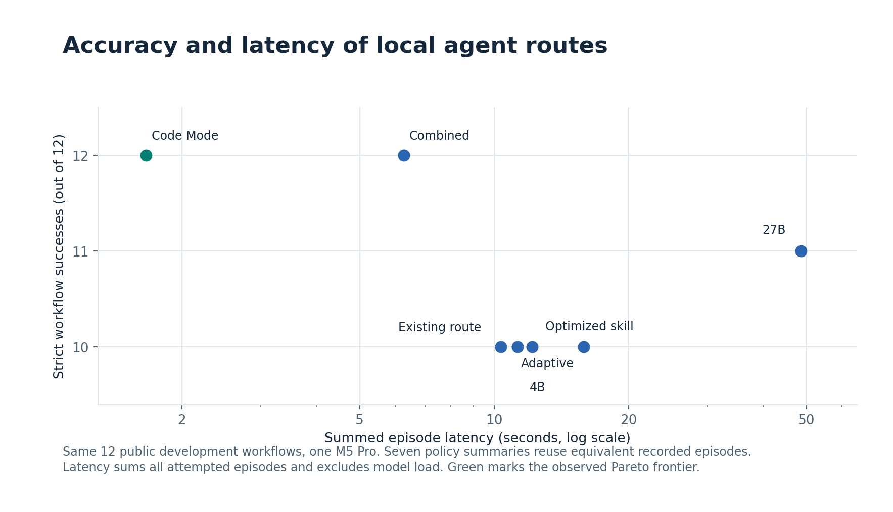

# Local agent optimization: The accuracy, latency and memory trade-offs

**Zayyan Latif**

The original manuscript is © 2026 Zayyan Latif and licensed under Creative Commons Attribution 4.0 International. [CC BY 4.0](https://creativecommons.org/licenses/by/4.0/)

A deterministic typed path with a 4B fallback completed **12/12** local development workflows in **1.664 seconds** summed across requests, compared with **10/12 in 11.273 seconds** for the plain 4B arm. None of four separate public-validation families had a deterministic binding. The typed policy therefore fell back to the 4B and both scored 2/4, while the 27B scored 4/4. Separating routing coverage from model quality explains both results.

## Accuracy and request latency

AgentEfficiencyBench compares different execution policies on matched benign local simulations. A typed binding supplies deterministic code for an explicitly supported workflow. The fallback uses the 4B model for workflows without such a binding. The adaptive comparator uses predeclared case metadata and selects an arm before running. The benchmark reused identical execution plans across arms. That yielded 49 actual executions supporting 84 policy rows on 12 development cases. These are policy comparisons on shared observations, so the seven rows do not provide independent timing samples. Total runtime uses the sum across loaded-worker workflow requests.

| Development policy | Strict success | Summed workflow time | Generated tokens |
|---|---:|---:|---:|
| Plain 4B | 10/12 | 11.273 s | 418 |
| Plain 27B | 11/12 | 48.615 s | 431 |
| Existing typed-ID route with 4B fallback | 10/12 | 10.354 s | 383 |
| Predeclared adaptive escalation | 10/12 | 15.868 s | 418 |
| 4B with workflow skill | 10/12 | 12.170 s | 455 |
| Code Mode with 4B fallback | 12/12 | 1.664 s | 56 |
| Combined typed route and model escalation | 12/12 | 6.277 s | 56 |

The combined policy spent more time than typed routing with the same observed outcomes and total token count. On the separate public-validation cohort, the 27B's four exact passes took 12.043 seconds in total, while workflow skill and combined each scored 3/4. A different six-variant ablation of one incident workflow scored 3/6 with no skill, 5/6 with generic skill, 4/6 with a model-specific skill, 6/6 with Code Mode and 6/6 with Code Mode followed by model formatting. The formatter was a separate model turn. These tests show sensitivity to workflow family, prompt and binding coverage. [AgentEfficiencyBench and scope](../benchmarks/README.md) · [Ablation figure](../figures/workflow-ablations.png)

## Fixed-workload precision and throughput

Inference ran on one Apple M5 Pro with 48 GiB unified memory. The official MLX-LM harness measured generation-phase throughput for fixed token workloads. Each cell contains three repeated trials, with 72 timed runs across the full precision and batching matrix. At 2,048 input tokens and batch one, affine INT8 and INT4 both use group 64 and derive from the corresponding adapted BF16 export. WeightForge in this experiment is the step-12 LoRA merged export. Sentry here is the historical 0.6B export. Checkpoint identities matter when comparing latency and quality across studies. [Official MLX-LM benchmark operation](https://github.com/ml-explore/mlx-lm/blob/v0.31.3/mlx_lm/benchmark.py) · [Local provenance](../provenance/README.md)

| Historical checkpoint | Precision | Generation throughput | Peak MLX allocator |
|---|---|---:|---:|
| WeightForge 4B step 12 | BF16 | 31.9 tokens/s | 10.04 GB |
| WeightForge 4B step 12 | INT8 | 56.1 tokens/s | 6.16 GB |
| WeightForge 4B step 12 | INT4 | 97.3 tokens/s | 4.15 GB |
| Sentry 0.6B | BF16 | 169.8 tokens/s | 2.14 GB |
| Sentry 0.6B | INT8 | 250.8 tokens/s | 1.75 GB |
| Sentry 0.6B | INT4 | 322.1 tokens/s | 1.46 GB |

At the same input length, increasing historical INT4 batch width from one to four raised aggregate generation throughput from 97.3 to 240.3 tokens/s for the 4B and 322.1 to 517.5 tokens/s for the 0.6B. End-to-end delivered throughput, including the official benchmark's measured prefill and generation time, increased more modestly from 39.2 to 53.2 and from 162.4 to 236.2 tokens/s. Peak allocator memory rose to 7.05 GB for the 4B and 1.91 GB for the 0.6B. The synthetic fixed-token benchmark measures engine capacity. Streaming copy separately measures response exactness and arrival latency. Both WeightForge INT4 variants hit 5/5 exact resident copies at 2,048 tokens. The historical Sentry 0.6B parent scored 5/5 while the adapted export scored 0/5 under that same copy request, so their latency includes different output behavior. [Measured memory and throughput](../figures/official-precision-memory-throughput.png) · [Benchmark evidence](../evidence/)

The separate resident copy workload at 4,096 requested input tokens measured 84.5 versus 17.2 tokens/s post-first-token decode for the 4B and 27B and 3.93 versus 17.01 GiB of peak MLX memory. A cached prefix cut reported time to first token from 1,844 to 160 ms for the 4B and from 10,816 to 439 ms for the 27B. Including the cost of filling the prefix kept total client time at 2.31 seconds for the 4B and changed 13.04 to 13.30 seconds for the 27B on this workload. The larger model's cache-ready speedup addresses repeated-prefix requests. [Resident memory plot](../figures/resident-memory-throughput.png) · [LocalInferenceBench](../benchmarks/README.md)

The selected Qwen3-1.7B Sentry advisory pilot used one finite-choice forward pass per rendered prompt. On 232 matched prompts, the BF16 parent measured 36.64 ms p50, 37.62 ms p95 and 3.683 GB peak allocator, compared with 42.34 ms p50, 44.00 ms p95 and 4.002 GB for the rank-4 adapter. This includes selecting trusted input within the matching scope, rendering, tokenization and three-logit forward/readback with 238–270 prompt tokens. Model loading, decoding, evidence rendering and dispatch are outside that measurement. [Checkpoint provenance](../provenance/README.md)

The standalone packages provide a separate way to test the tools. AgentEfficiencyBench replays fictional workflow traces. WeightRegressionBench grades fictional static calls and accepts separately acquired BFCL inputs. MCP-EnforceBench checks simulated scope and grounding, and LocalInferenceBench reports on fabricated cold and resident observations. Freshly extracted packages passed offline smoke checks on those fictional controls. Historical experiment cases, model observations and reference answers stay outside the archives. [Benchmark package receipts](../benchmarks/README.md) · [Release index](../README.md)
