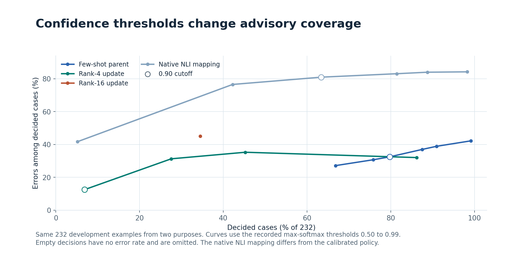
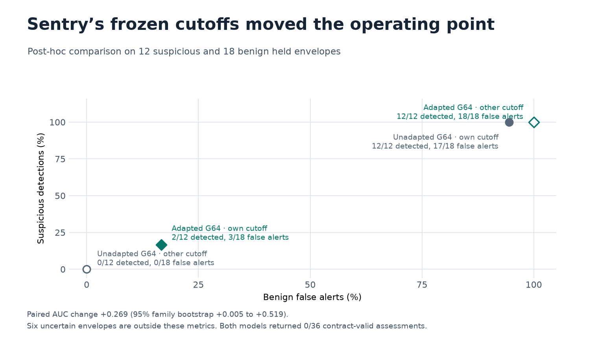

# MCP Guard Sentry: Advisory intent matching with deterministic authority

**Zayyan Latif**

The original manuscript is © 2026 Zayyan Latif and licensed under Creative Commons Attribution 4.0 International. [CC BY 4.0](https://creativecommons.org/licenses/by/4.0/)

MCP Guard Sentry studies whether a local model can identify disagreement between the user's trusted purpose and a proposed action. A Qwen3-1.7B rank-4 adaptation improved native status-and-evidence accuracy from **135/232 to 158/232** in a matched development comparison. It also missed all 16 unresolved decisions in that native mode, compared with five correct clarifications for the parent. Separate confidence thresholds produced fewer wrong permissive matches, substantial deferral, and fewer correct joint decisions than the calibrated parent. A policy gate remains responsible for execution authority.

## Comparing intent with a proposal

The study groups synthetic proposals by purpose. A matched pair holds the proposal, receipt, distractor and reference IDs fixed while changing the trusted statement. The model chooses one of three finite status tokens, match, mismatch or clarify. The application binds evidence references from the mock scope and renders the response. The status can be replayed directly from the logits. The joint workflow assessment uses that status and the application’s bound references. The experiment has no operation dispatcher.

The exact BF16 checkpoint was Qwen3-1.7B at `70d244cc86ccca08cf5af4e1e306ecf908b1ad5e`. The rank-4 run applied 48 updates to a 184-record sample drawn from a 464-record fitting pool. The assistant label and end marker were the only supervised positions. Audio-level records supplied 64 separate calibration decisions. The 232-record development cohort used alarm and media families. Natural request fragments came from the English MASSIVE TRAIN partition, whose English text derives from SLURP. Both sources use CC BY 4.0. Fit, calibration and development exclude overlapping source IDs and normalized utterances where source identifiers are available. An independent sample check agreed on the status and evidence IDs for 18 shuffled natural development records. [Model and data provenance](../provenance/README.md) · [Qwen checkpoint](https://huggingface.co/Qwen/Qwen3-1.7B/tree/70d244cc86ccca08cf5af4e1e306ecf908b1ad5e) · [Amazon MASSIVE](https://github.com/alexa/massive) · [SLURP source and license](https://github.com/pswietojanski/slurp/blob/8eb16545762be97ace75334109d73824217311f1/README.md#license)

| Same three-example prompt | Native joint correctness | Wrong native matches | Calibrated joint correctness | Wrong calibrated matches |
|---|---:|---:|---:|---:|
| Exact BF16 parent | 135/232 | 38/124 | 112/232 | 7/124 |
| BF16 parent with rank-4 adapter | 158/232 | 9/124 | 101/232 | 4/124 |
| BF16 parent with rank-16 adapter | 116/232 | 108/124 | 25/232 | 0/124 |

The smaller adapter recognized 101/108 definite mismatches in native mode and none of 16 unresolved cases. Calibration recognized 14/16 unresolved cases but led to 102 false clarifications among 216 informative cases, versus the parent's 88. In a separate descriptive confidence analysis at 0.90, the rank-4 model gave 16 decisions with two errors. The parent gave 185 with 60 errors. The rank-16 model gave zero decisions, leaving its error rate undefined. Interpreting the error rate requires reporting coverage. [Aggregate evidence](../evidence/) · [Plotted values](../figures/README.md)

A fresh 112-case development panel with a shared clarification stage separated radio from podcasts and forecasts from headlines. The rank-4 arm improved from 60/112 to 73/112 joint decisions versus the factored parent, with 18 gains and five losses. A fixed pretrained NLI control scored 80/112 and a visible purpose cue rule scored 104/112. That cue rule uses vocabulary from this fixture. The result shows what these baselines can do in a narrow setting. The rank-4 adapter remained an advisory research candidate.

## Separate checkpoints and benchmarks

An earlier 0.6B INT4 generative adaptation is a different artifact and remains quarantined. Both its parent and adapted export produced zero valid strict outputs across 36 independently authored authorization envelopes. A post-hoc paired discrimination audit on the same panel found AUROC 0.403→0.671 for twelve suspicious and eighteen benign examples, excluding six uncertain outcomes. At their separately frozen cutoffs, the INT4 parent detected 12/12 suspicious examples with 17/18 benign alerts. The adapted export detected 2/12 with 3/18 benign alerts. Better ranking coexisted with poor coverage and an unmet output contract. On 339 all-benign NotInject examples, separately calibrated thresholds alerted on 91 for the same-source INT4 parent and 32 for the adapted export. Both produced zero valid strict outputs there. A benign-only corpus measures false alerts and cannot estimate detection recall. [Aggregate evidence](../evidence/) · [NotInject source](https://huggingface.co/datasets/leolee99/NotInject/tree/847ae76cf8fea5ed325429e569ae8cf022d2e0)

The separate Sentry advisory classifier improved tie-grouped average precision from 0.716 to 0.823 over a word-set baseline on 20 matched allowed/denied proposal pairs from ten original mock families. The 50% positive prevalence, shared family structure and small sample inform the curve. That metric concerns proposal-context ranking for an older classifier. It does not transfer to the 1.7B candidate. [Precision–recall measurements](../figures/sentry-advisory-precision-recall.png)

Two separate evidence checks measured grounding. A five-candidate Doc2Dial retrieval study found the native source span on 15/34 questions for frozen MiniLM, 12/34 for a character-level baseline and 8/34 for a fitted ranker. All questions were answerable and came from four TRAIN pages. A separate 96-case claim-support study accepted 20/42 supported claims with the Granite baseline and 26/42 with pretrained NLI at the tested thresholds. Neither accepted an opposing or unresolved claim. These tasks measure different forms of evidence coverage. [Grounding figure](../figures/grounding-and-coverage.png) · [Doc2Dial project](https://github.com/doc2dial/sharedtask-dialdoc2021)

The application can check allowed scope and bind exact provenance independently of model predictions. The portable MCP-EnforceBench exercises deterministic scope and grounding checks over synthetic fixtures. An advisory model can supply a status or explanation, with the application retaining authorization and evidence checks. [Benchmark package](../benchmarks/README.md) · [Publication terms](../PUBLICATION-TERMS.md) · [Release index](../README.md)
