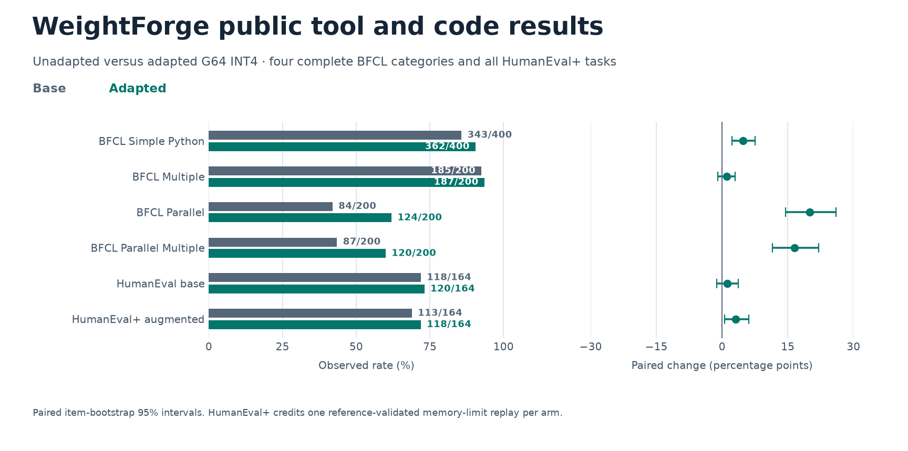
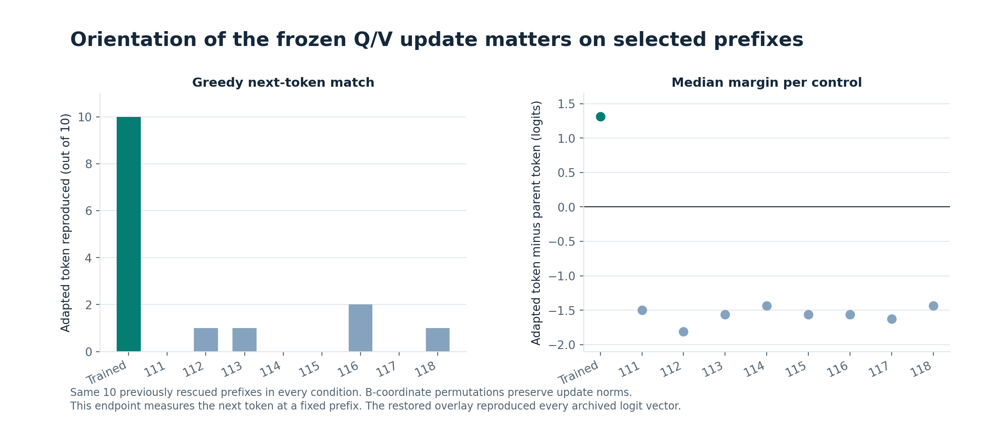

# WeightForge: Improving native tool calls and measuring what transfers

**Zayyan Latif**

The original manuscript is © 2026 Zayyan Latif and licensed under Creative Commons Attribution 4.0 International. [CC BY 4.0](https://creativecommons.org/licenses/by/4.0/)

WeightForge tests whether model-level changes improve local agents that emit native function calls. A runnable Qwen3.5-4B derivative improved from **699/1,000 to 793/1,000** on four static Python categories in the Berkeley Function-Calling Leaderboard (BFCL). It then regressed from **15/16 to 14/16** on a separate independent multistep workflow panel. A later strategy that adapted queries and values improved an open development cohort, but tied the parent on two transfer panels. The benchmark gains and workflow results measure different behavior.

## Matched checkpoints and evaluation

The packaged tool-call experiment starts from the verified `Qwen/Qwen3.5-4B` checkpoint at `851bf6e806efd8d0a36b00ddf55e13ccb7b8cd0a`. Supervised training used native tool-call turns in synthetic workflows. The selected rank-8 LoRA received 12 supervised updates and 428 target tokens across seven training families. It was fused into BF16 before affine group-64 INT4 export. The parent control was quantized separately from the identical upstream checkpoint with the same precision and group size. The scoring path used the native decoder and the pinned upstream Python AST grader. The paired BFCL run used the same 192-token output cap and batch width of 16 in both arms. [Checkpoint provenance](../provenance/README.md) · [Qwen checkpoint and license](https://huggingface.co/Qwen/Qwen3.5-4B/tree/851bf6e806efd8d0a36b00ddf55e13ccb7b8cd0a) · [Upstream BFCL grader](https://github.com/ShishirPatil/gorilla/tree/f7cf7359b7ac615a0b294831c5ba2bc95ee4a000/berkeley-function-call-leaderboard)

| BFCL v4 static Python category | Matched INT4 parent | Step-12 adapted INT4 | Paired difference, 95% item-bootstrap interval |
|---|---:|---:|---:|
| Simple | 343/400 | 362/400 | +4.75 pp [+2.25, +7.50] |
| Multiple | 185/200 | 187/200 | +1.00 pp [−1.00, +3.00] |
| Parallel | 84/200 | 124/200 | +20.00 pp [+14.50, +26.00] |
| Parallel Multiple | 87/200 | 120/200 | +16.50 pp [+11.50, +22.00] |

The descriptive four-category total contains 101 parent failures fixed and seven new failures. The two parallel-call categories contributed 73 of the 94 net gains. The comparison covers these four static categories. The category intervals use 10,000 paired item resamples and describe this benchmark protocol. [Benchmark and audit evidence](../evidence/)

On the independent workflow test the adaptation lost one recovery case and fixed none. Strict state success went from 16/16 to 15/16, and recovery success from 3/3 to 2/3. The −6.25 percentage point strict workflow difference had a paired family-bootstrap interval of [−18.75, 0]. A separate two-case retail simulation found a premature write request and blocked it in the dispatcher. Broader capability was mixed. HumanEval+ rose from 113/164 to 118/164 after a bounded replay resolved a shared reference RSS failure. MATH-500 fell from 258/500 to 249/500 at a 768-token cap, using symbolic equivalence with boxed LaTeX prioritized. IFEval strict-prompt correctness moved from 411/541 to 413/541 under the upstream scorer. These outcomes keep the artifact at research status. [Benchmark packages](../benchmarks/README.md) · [Audit evidence](../evidence/)

## A later query/value intervention

The later qv64 experiment attaches a rank-4 adapter with 57,344 trainable factors to the last full-attention block of the INT4 parent. It used data mined from genuine train-only mistakes. The parent scored 11/24 and qv64 scored 21/24 on the first open development cohort, with ten gains and zero losses. Under new schemas and values each scored 6/12. On four other independently authored mechanisms each scored 1/12 and attempted three wrong writes. A domain-specific deterministic controller passed 12/12 on that last panel. The qv64 comparison has a different adapter and training protocol from the BFCL step-12 pair. The qv64 control also matched the parent at 45/80 on a five-subject MMLU-Pro subset and 8/8 on a RULER variable-tracking slice. Its full IFEval result moved from 411 to 412 of 541 and its GPQA Diamond result from 77 to 75 of 198. [Scope and receipts](../evidence/)

At one cached divergent position for each of ten previously rescued development workflows, the intact qv64 adapter preserved all ten target-token decisions. A query-only projection preserved nine and value-only preserved two. Eight seeded norm-preserving orientation controls recovered zero to two each. Full logit restoration after rollback was exact. This tests the orientation of the intervention at selected states. The ten states came from the earlier wins and provide no independent estimate of workflow improvement. [Figure data and scope](../figures/README.md)

A separate same-source Qwen3.5-0.8B precision study scored 6/12 in BF16, 6/12 in INT4 group 64 and 8/12 in INT4 group 32. Group 32 required 11.1% more tensor bytes than group 64. An attention intervention in that model localized one warehouse call failure to a tested block and repaired the call when the relevant state was swapped. This is a different model and selected example. [Precision comparison](../figures/same-source-quantization.png) · [Localization](../figures/reciprocal-weight-localization.png)

The adapter, fused export and runtime are separately identified in the release provenance. Distribution terms and the research status apply to the staged artifacts. [Publication terms](../PUBLICATION-TERMS.md) · [Release index](../README.md)
